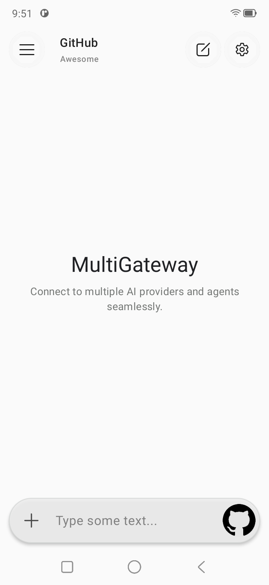

<p align="center">
  
</p>

# Generative

<p align="center">
  <a href="https://github.com/starfall-org/generative"></a>
  
  
  
  
  
  
  
  
  
  
  <a href="LICENSE"></a>
</p>

<p align="center">
  
</p>

Generative is a native Android app for chatting with AI models from multiple providers in one place. Configure your own provider accounts and endpoints, manage conversations locally, connect remote MCP tools, and use supported image and video generation features from a single Material 3 interface.

> **Development status:** Generative is actively developed. Features and settings may change between versions.

## What you can do

- **Use different AI providers:** OpenAI-compatible Chat Completions, OpenAI Responses, Anthropic, Google Gemini, Ollama, and supported account-based providers such as ChatGPT Codex, Claude Code, Antigravity, and GitHub Copilot.
- **Configure providers and models separately:** set endpoints, authentication, headers, model catalogs, sampling options, capabilities, tool support, and streaming preferences.
- **Keep conversations on your device:** conversation history and app configuration are stored locally.
- **Connect remote MCP servers:** use Streamable HTTP or legacy HTTP + SSE servers and choose which tools are enabled.
- **Use system tools:** where supported and configured, generate images or videos and access resulting media from the chat.
- **Manage tool results and files:** inspect and open larger outputs without placing all of their contents directly into the conversation.
- **Use speech features:** configure speech services and Android text-to-speech.
- **Organize your setup:** use profiles and per-model settings to adapt conversations to different tasks.

Provider availability, model capabilities, and billing are determined by the services and accounts you configure. Generative does not provide AI API access or cover provider usage charges.

## Getting started

1. Install and open Generative on an Android device.
2. Add a provider in the Providers area. Choose a supported provider type and enter its endpoint and authentication details, or follow the sign-in flow for an account-based provider.
3. Add or refresh the models available from that provider, then choose a model for a conversation.
4. If needed, configure profiles, MCP servers, speech services, or system media tools in their respective settings.

Keep API keys and account credentials private. Use HTTPS for remote endpoints whenever possible. Only connect MCP servers you trust, since enabled tools may be able to access or modify data exposed by those services.

## Provider settings

Provider settings control the endpoint, authentication, headers, model catalog, and default streaming behavior. Model settings control options such as model type, sampling parameters, capabilities, tool support, and an optional streaming override. When the model-level streaming option is unset, it inherits the provider default.

### Quick-add provider links

Generative can accept a link from a browser or another app to save a new provider and open its Edit Provider screen.

URI format (replace placeholders with percent-encoded values):

```text
mg://provider?name={name}&url={url}&key={key}&auth_type={auth_type}&provider_type={provider_type}&icon_url={icon_url}
```

Example:

```text
mg://provider?name=My%20Gateway&url=https%3A%2F%2Fapi.example.com%2Fv1&key=YOUR_API_KEY&auth_type=platform&provider_type=chat-completions&icon_url=https%3A%2F%2Fexample.com%2Ficon.png
```

- `provider_type` defaults to `chat-completions`. Other supported values include `responses`, `anthropic`, `gemini`, `ollama`, `antigravity`, `github-copilot`, `openai-codex`, and `claude-code`.
- `auth_type` defaults to `platform`. Other values include `none`, `bearer`, `query`, `custom-header`, and `oauth`.
- `key` is a credential value. The editor lets you adjust authentication details; OAuth providers use the editor's sign-in flow.
- `icon_url` is optional and must be an HTTP(S) image URL.
- Percent-encode parameter values, especially URLs or keys containing `&`, `+`, `=`, or `%`.
- The legacy `generative://` scheme and `type`/`auth` parameter names are also accepted.

Each deliberate opening creates a new provider rather than overwriting one with the same name or URL. Provider details are saved before the editor opens. Treat quick-add links containing credentials as sensitive and do not share them publicly.

## Account sign-in

For supported account-based providers, open the provider's settings and use its sign-in flow. Some providers return to the app through a local callback; GitHub Copilot uses a device verification code. Credentials are stored locally using Android Keystore-backed encryption. After importing configuration on another device, sign in again where required.

## MCP and media tools

Remote MCP servers can use Streamable HTTP or legacy HTTP + SSE. STDIO transport is not exposed because Generative is an Android client and does not run arbitrary local MCP processes. You can enable or disable available tools per server/tool. Tool output is bounded in the conversation, and larger results may be stored as files.

Image and video generation are available when the relevant system tool and compatible provider model are configured. Generated media returned as URLs or base64 data is stored as local files and referenced from the chat interface.

## Platform

Generative is currently an Android-native app built with Kotlin and Jetpack Compose. iOS, web, Windows, macOS, and Linux versions are not currently provided.

## Contributing

If you want to suggest a change or contribute to the project, read [CONTRIBUTING.md](CONTRIBUTING.md) for the contribution scope, code organization, and validation guidance.

### Lightweight storage validation (no Gradle)

With Python 3.10+ and standard-library SQLite, run
`python3 -B -m unittest discover -s scripts -p 'test_phase5_*.py'` to test the
offline validation tools, then `python3 -B scripts/validate-phase5.py` to inspect
the current source/schema snapshot. These checks do not build the app or certify
Android migrations. See [Phase 5 validation](docs/phase5-validation.md) for
resource limits, optional synthetic timings, exit codes and outstanding checks.

## License

[](https://raw.githubusercontent.com/starfall-org/generative/refs/heads/main/LICENSE)

This project is licensed under the **Starfall Org Contributor Commercial Copyleft License v1.0**. The app itself must remain non-commercial; an unmodified official APK built and released by Starfall Org may be included in an otherwise commercial product under the conditions in the license. Publishing or distributing the app through Google Play or another app store requires prior written permission from Starfall Org. Corresponding-source and attribution obligations still apply. Read [LICENSE](LICENSE) for the complete terms.
